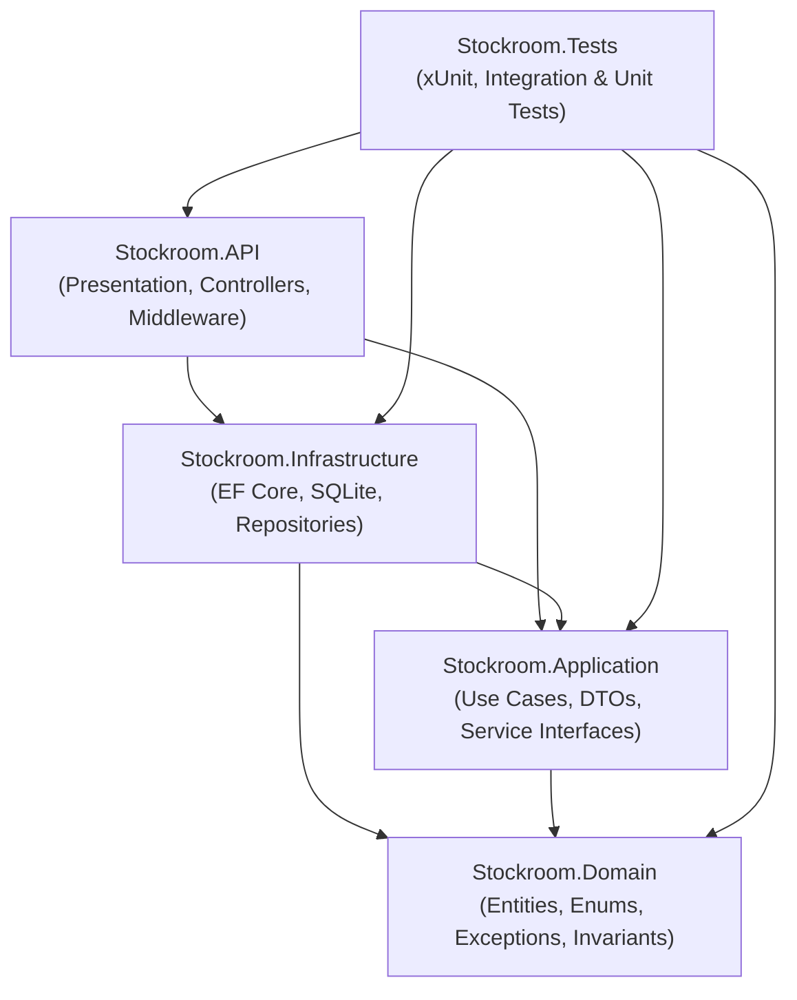

# Stockroom — Inventory Management REST API

Stockroom is a production-grade, lightweight Inventory Management REST API built with **C#** and **ASP.NET Core** following the principles of **Clean Architecture**. It provides end-to-end inventory tracking, stock movements audit logging, low-stock threshold alerting, and real-time inventory valuation.

---

## Table of Contents

- [Overview & Problem Solved](#overview--problem-solved)
- [Key Features](#key-features)
- [Architecture & Design](#architecture--design)
- [Technology Stack](#technology-stack)
- [Project Structure](#project-structure)
- [Prerequisites](#prerequisites)
- [Getting Started](#getting-started)
- [Database Migrations](#database-migrations)
- [API Endpoints & Documentation](#api-endpoints--documentation)
  - [Products](#products)
  - [Stock Operations & Audit History](#stock-operations--audit-history)
  - [Inventory Reporting](#inventory-reporting)
- [Business Rules & Invariants](#business-rules--invariants)
- [Validation & Error Handling](#validation--error-handling)
- [Testing](#testing)
- [Known Limitations](#known-limitations)
- [Future Improvements](#future-improvements)

---

## Overview & Problem Solved

Traditional inventory systems frequently suffer from data anomalies:
1. **Silent stock discrepancies**: Balance numbers changed directly without an audit trail of who or what changed them.
2. **Negative inventory**: Overselling or removing more units than actually exist in the warehouse.
3. **Audit trail deletion**: Deleting catalog items that destroy historic financial ledger records.
4. **Floating-point rounding errors**: Precision loss when aggregating stock values.

**Stockroom solves these problems** by:
- Enforcing **domain-level business invariants** (non-negative stock, positive adjustment quantities).
- Guaranteeing **atomic persistence**: product balance changes and immutable audit movements either persist together or fail together.
- Recording an **immutable audit log** for every stock-in and stock-out event (including initial balances upon product creation).
- Prohibiting accidental deletion of products that have historic movement history or active stock.
- Performing **safe decimal arithmetic** for financial valuations.

---

## Key Features

- **Product Catalog Management**: Create, view, update, and search products with unique SKU enforcement, pagination, and filtering.
- **Atomic Stock Adjustments**: Dedicated `/stock-in` and `/stock-out` endpoints that guarantee balance updates and audit trail persistence inside database transactions.
- **Immutable Movement Audit Records**: Chronological, read-only ledger capturing before/after balances, quantities, timestamps (UTC), and optional transaction notes.
- **Low-Stock Alerting**: Instant detection of products needing replenishment (`QuantityInStock <= LowStockThreshold`). Products configured with a threshold of `0` are intentionally excluded from alerts.
- **Inventory Valuation & Metrics**: High-level reporting of total catalog items, total units on hand, low-stock item count, and cumulative inventory value calculated in memory using exact decimal arithmetic.
- **RFC 9110 / RFC 7807 Compliance**: Centralized error handling returning standardized `ProblemDetails` for 400 Bad Request, 404 Not Found, 409 Conflict, and 500 Internal Server Error without leaking internal stack traces.
- **Interactive Developer UI**: Integrated **Scalar** interactive API documentation alongside OpenAPI specifications.

---

## Architecture & Design

Stockroom follows **Clean Architecture** (Ports and Adapters / Onion Architecture). Dependencies strictly point inward toward the Domain core:



### Dependency Rules:
1. **Stockroom.Domain**: Contains core business entities (`Product`, `StockMovement`), domain exceptions, and domain logic. Has zero external dependencies (no EF Core, no HTTP, no external frameworks).
2. **Stockroom.Application**: Defines repository abstractions (`IProductRepository`, `IStockMovementRepository`, `IUnitOfWork`), application service interfaces, request/response DTOs, and orchestrates use cases. Depends only on Domain.
3. **Stockroom.Infrastructure**: Implements persistence using Entity Framework Core and SQLite, defines database mappings, runs migrations, and handles database transactions. Depends on Application and Domain.
4. **Stockroom.API**: Presentation layer containing ASP.NET Core controllers (`ProductsController`, `InventoryController`), OpenAPI / Scalar configuration, and centralized `GlobalExceptionHandler`. Acts as the composition root.
5. **Stockroom.Tests**: Unit and integration tests validating domain rules, application services, and full HTTP endpoints via `WebApplicationFactory`.

> [!NOTE]
> In alignment with clean design principles, this project intentionally avoids unnecessary abstractions such as MediatR, CQRS frameworks, event sourcing, or microservices libraries, keeping the codebase simple, explicit, and easy to maintain.

---

## Technology Stack

- **Platform / SDK**: .NET 10 (C# 13)
- **Framework**: ASP.NET Core Web API with Controllers
- **ORM**: Entity Framework Core 10 (`Microsoft.EntityFrameworkCore.Sqlite`)
- **Database**: SQLite (local file-based storage with transactional support)
- **API Documentation**: Microsoft OpenAPI (`Microsoft.AspNetCore.OpenApi`) + **Scalar** (`Scalar.AspNetCore`)
- **Testing**: xUnit, `Microsoft.AspNetCore.Mvc.Testing`, SQLite In-Memory

---

## Project Structure

```
Stockroom/
├── Stockroom.sln                                # Visual Studio solution
├── Stockroom.slnx                               # Modern XML solution
├── dotnet-tools.json                            # Local .NET CLI tool manifest (dotnet-ef)
├── .gitignore                                   # Git ignore rules
├── README.md                                    # Documentation
├── src/
│   ├── Stockroom.Domain/                        # Domain Layer (Enterprise Core)
│   │   ├── Entities/
│   │   │   ├── Product.cs                       # Product aggregate & business invariants
│   │   │   └── StockMovement.cs                 # Immutable audit movement entity
│   │   ├── Enums/
│   │   │   └── StockMovementType.cs             # StockIn, StockOut
│   │   └── Exceptions/
│   │       └── DomainExceptions.cs              # Domain-specific business exceptions
│   │
│   ├── Stockroom.Application/                   # Application Layer (Use Cases)
│   │   ├── DTOs/
│   │   │   ├── Common/PagedResponse.cs          # Generic pagination wrapper
│   │   │   ├── Products/ProductDTOs.cs          # Create/Update/Query Product DTOs
│   │   │   ├── StockMovements/StockMovementDTOs.cs # StockIn/StockOut request/response DTOs
│   │   │   └── Inventory/InventoryDTOs.cs       # Inventory summary DTOs
│   │   ├── Interfaces/
│   │   │   ├── IProductRepository.cs
│   │   │   ├── IStockMovementRepository.cs
│   │   │   ├── IUnitOfWork.cs
│   │   │   ├── IProductService.cs
│   │   │   └── IInventoryService.cs
│   │   ├── Services/
│   │   │   ├── ProductService.cs                # Product catalog use cases
│   │   │   └── InventoryService.cs              # Stock management & metrics use cases
│   │   └── DependencyInjection.cs
│   │
│   ├── Stockroom.Infrastructure/                # Infrastructure Layer (Data & Persistence)
│   │   ├── Data/
│   │   │   ├── StockroomDbContext.cs            # EF Core DbContext
│   │   │   ├── StockroomDbContextFactory.cs     # Design-time factory for EF CLI
│   │   │   ├── UnitOfWork.cs                    # Transaction & save changes coordinator
│   │   │   ├── Configurations/
│   │   │   │   ├── ProductConfiguration.cs      # EF mappings, indexes, constraints
│   │   │   │   └── StockMovementConfiguration.cs# Audit log configuration & composite indexes
│   │   │   └── Migrations/                      # EF Core SQLite schema migrations
│   │   ├── Repositories/
│   │   │   ├── ProductRepository.cs
│   │   │   └── StockMovementRepository.cs
│   │   └── DependencyInjection.cs
│   │
│   └── Stockroom.API/                           # Presentation Layer (API Host)
│       ├── Controllers/
│       │   ├── ProductsController.cs            # Product & stock management endpoints
│       │   └── InventoryController.cs           # Low-stock & summary reporting endpoints
│       ├── Middleware/
│       │   └── GlobalExceptionHandler.cs        # Centralized RFC 9110 ProblemDetails handler
│       ├── Program.cs                           # Composition root & middleware pipeline
│       ├── appsettings.json
│       └── appsettings.Development.json
│
└── tests/
    └── Stockroom.Tests/                         # Automated Tests
        ├── Domain/
        │   ├── ProductTests.cs                  # Unit tests for domain invariants
        │   └── StockMovementTests.cs            # Unit tests for movement records
        ├── Application/
        │   ├── ProductServiceTests.cs           # Use case & business logic tests
        │   └── InventoryServiceTests.cs         # Stock adjustment & report tests
        ├── Integration/
        │   ├── CustomWebApplicationFactory.cs   # In-memory test host setup
        │   └── ApiEndpointsTests.cs             # Full E2E HTTP integration tests
        └── TestHelpers/
            └── SqliteTestDatabase.cs            # Isolated SQLite in-memory helper
```

---

## Prerequisites

- [.NET 10 SDK](https://dotnet.microsoft.com/download) (or .NET 9 if targeting compatible framework)
- Terminal / CLI (macOS, Linux, or Windows)

Verify your installed SDK version:
```bash
dotnet --version
```

---

## Getting Started

### 1. Clone the repository
```bash
git clone <repository-url>
cd Stockroom
```

### 2. Restore local tools & packages
```bash
dotnet tool restore
dotnet restore
```

### 3. Build the solution
```bash
dotnet build Stockroom.sln
```

### 4. Run the API
```bash
dotnet run --project src/Stockroom.API
```

The application will automatically initialize the local SQLite database (`stockroom.db`) and apply pending migrations on startup.

### 5. Access Interactive API Documentation
Open your browser to:
- **Scalar UI**: `http://localhost:5000/scalar/v1` (or HTTPS port shown in console)
- **OpenAPI Document**: `http://localhost:5000/openapi/v1.json`

---

## Database Migrations

Entity Framework Core migrations are located in `Stockroom.Infrastructure/Data/Migrations`.

To add a new migration:
```bash
dotnet dotnet-ef migrations add <MigrationName> \
  --project src/Stockroom.Infrastructure \
  --startup-project src/Stockroom.Infrastructure \
  --output-dir Data/Migrations
```

To manually apply migrations to the database:
```bash
dotnet dotnet-ef database update \
  --project src/Stockroom.Infrastructure \
  --startup-project src/Stockroom.Infrastructure
```

---

## API Endpoints & Documentation

All error responses use the standard `application/problem+json` (`ProblemDetails`) schema.

### Products

#### 1. Create Product
- **Method**: `POST`
- **Route**: `/api/products`
- **Status**: `201 Created` (with `Location` header)
- **Description**: Creates a new product. If `initialQuantity > 0`, an initial `StockIn` movement is atomically recorded so the audit history aligns with starting stock.

**Request Body**:
```json
{
  "name": "Mechanical Keyboard Pro",
  "sku": "KB-MECH-01",
  "description": "Tenkeyless mechanical keyboard with hot-swappable switches",
  "unitPrice": 129.99,
  "initialQuantity": 25,
  "lowStockThreshold": 5
}
```

**Response (201 Created)**:
```json
{
  "id": 1,
  "name": "Mechanical Keyboard Pro",
  "sku": "KB-MECH-01",
  "description": "Tenkeyless mechanical keyboard with hot-swappable switches",
  "unitPrice": 129.99,
  "quantityInStock": 25,
  "lowStockThreshold": 5,
  "isLowStock": false,
  "createdAtUtc": "2026-10-15T13:21:40Z",
  "updatedAtUtc": "2026-10-15T13:21:40Z"
}
```

---

#### 2. List Products
- **Method**: `GET`
- **Route**: `/api/products?page=1&pageSize=10&search=keyboard&lowStockOnly=false`
- **Status**: `200 OK`
- **Query Parameters**:
  - `page` *(optional, default: 1)*: Page number (>= 1).
  - `pageSize` *(optional, default: 10, max: 100)*: Items per page.
  - `search` *(optional)*: Case-insensitive search on `name` or `SKU`.
  - `lowStockOnly` *(optional)*: Filter products where `QuantityInStock <= LowStockThreshold`.

**Response (200 OK)**:
```json
{
  "items": [
    {
      "id": 1,
      "name": "Mechanical Keyboard Pro",
      "sku": "KB-MECH-01",
      "description": "Tenkeyless mechanical keyboard with hot-swappable switches",
      "unitPrice": 129.99,
      "quantityInStock": 25,
      "lowStockThreshold": 5,
      "isLowStock": false,
      "createdAtUtc": "2026-10-15T13:21:40Z",
      "updatedAtUtc": "2026-10-15T13:21:40Z"
    }
  ],
  "page": 1,
  "pageSize": 10,
  "totalCount": 1,
  "totalPages": 1
}
```

---

#### 3. Get Product by ID
- **Method**: `GET`
- **Route**: `/api/products/{id}`
- **Status**: `200 OK` or `404 Not Found`

---

#### 4. Update Product Metadata
- **Method**: `PUT`
- **Route**: `/api/products/{id}`
- **Status**: `200 OK`, `400 Bad Request`, `404 Not Found`, `409 Conflict`
- **Description**: Updates product details (name, SKU, description, unit price, low-stock threshold). **Does not alter inventory balance**; all balance adjustments must proceed through stock operations.

**Request Body**:
```json
{
  "name": "Mechanical Keyboard Pro (V2)",
  "sku": "KB-MECH-02",
  "description": "Updated model with sound-dampening foam",
  "unitPrice": 139.99,
  "lowStockThreshold": 8
}
```

---

#### 5. Delete Product
- **Method**: `DELETE`
- **Route**: `/api/products/{id}`
- **Status**: `204 NoContent`, `404 Not Found`, `409 Conflict`
- **Rule**: Deletion is prohibited and returns `409 Conflict` if the product has existing stock movement audit records (to preserve ledger integrity) or if the product has a remaining stock balance > 0.

**Response on Conflict (409 Conflict)**:
```json
{
  "type": "https://tools.ietf.org/html/rfc9110#section-15.5.10",
  "title": "Operation Prohibited",
  "status": 409,
  "detail": "Cannot delete product 'Mechanical Keyboard Pro' (ID: 1, SKU: KB-MECH-01) because historical stock movement audit records exist. Deleting this product would destroy inventory audit integrity.",
  "instance": "/api/products/1"
}
```

---

### Stock Operations & Audit History

#### 1. Receive Stock (Stock-In)
- **Method**: `POST`
- **Route**: `/api/products/{id}/stock-in`
- **Status**: `200 OK`, `400 Bad Request`, `404 Not Found`
- **Description**: Atomically increments stock balance and records a `StockIn` movement audit log.

**Request Body**:
```json
{
  "quantity": 10,
  "note": "Received supplier shipment PO #8821"
}
```

**Response (200 OK)**:
```json
{
  "product": {
    "id": 1,
    "name": "Mechanical Keyboard Pro",
    "sku": "KB-MECH-01",
    "quantityInStock": 35,
    "lowStockThreshold": 5,
    "unitPrice": 129.99,
    "isLowStock": false,
    "createdAtUtc": "2026-10-15T13:21:40Z",
    "updatedAtUtc": "2026-10-15T13:25:10Z"
  },
  "movement": {
    "id": 2,
    "productId": 1,
    "movementType": "StockIn",
    "quantity": 10,
    "quantityBefore": 25,
    "quantityAfter": 35,
    "note": "Received supplier shipment PO #8821",
    "createdAtUtc": "2026-10-15T13:25:10Z"
  }
}
```

---

#### 2. Remove Stock (Stock-Out)
- **Method**: `POST`
- **Route**: `/api/products/{id}/stock-out`
- **Status**: `200 OK`, `400 Bad Request`, `404 Not Found`, `409 Conflict`
- **Description**: Atomically decrements stock balance and records a `StockOut` movement audit log. Fails with `409 Conflict` if requested quantity exceeds available stock.

**Request Body**:
```json
{
  "quantity": 5,
  "note": "Dispatched order #SO-9910"
}
```

**Response (200 OK)**:
```json
{
  "product": {
    "id": 1,
    "name": "Mechanical Keyboard Pro",
    "sku": "KB-MECH-01",
    "quantityInStock": 30,
    "lowStockThreshold": 5,
    "unitPrice": 129.99,
    "isLowStock": false,
    "createdAtUtc": "2026-10-15T13:21:40Z",
    "updatedAtUtc": "2026-10-15T13:27:00Z"
  },
  "movement": {
    "id": 3,
    "productId": 1,
    "movementType": "StockOut",
    "quantity": 5,
    "quantityBefore": 35,
    "quantityAfter": 30,
    "note": "Dispatched order #SO-9910",
    "createdAtUtc": "2026-10-15T13:27:00Z"
  }
}
```

---

#### 3. View Movement History
- **Method**: `GET`
- **Route**: `/api/products/{id}/movements?page=1&pageSize=10`
- **Status**: `200 OK`, `404 Not Found`
- **Description**: Returns immutable audit movements for the product, sorted newest first.

**Response (200 OK)**:
```json
{
  "items": [
    {
      "id": 3,
      "productId": 1,
      "movementType": "StockOut",
      "quantity": 5,
      "quantityBefore": 35,
      "quantityAfter": 30,
      "note": "Dispatched order #SO-9910",
      "createdAtUtc": "2026-10-15T13:27:00Z"
    },
    {
      "id": 2,
      "productId": 1,
      "movementType": "StockIn",
      "quantity": 10,
      "quantityBefore": 25,
      "quantityAfter": 35,
      "note": "Received supplier shipment PO #8821",
      "createdAtUtc": "2026-10-15T13:25:10Z"
    },
    {
      "id": 1,
      "productId": 1,
      "movementType": "StockIn",
      "quantity": 25,
      "quantityBefore": 0,
      "quantityAfter": 25,
      "note": "Initial stock receipt upon product creation",
      "createdAtUtc": "2026-10-15T13:21:40Z"
    }
  ],
  "page": 1,
  "pageSize": 10,
  "totalCount": 3,
  "totalPages": 1
}
```

---

### Inventory Reporting

#### 1. Low-Stock Report
- **Method**: `GET`
- **Route**: `/api/inventory/low-stock`
- **Status**: `200 OK`
- **Description**: Retrieves products where `QuantityInStock <= LowStockThreshold`. Products configured with `LowStockThreshold == 0` are excluded from low-stock alerts.

---

#### 2. Inventory Summary
- **Method**: `GET`
- **Route**: `/api/inventory/summary`
- **Status**: `200 OK`
- **Description**: Summarizes inventory statistics across all products. Total inventory value represents current stock evaluated at recorded unit prices (`Sum(UnitPrice * QuantityInStock)`).

**Response (200 OK)**:
```json
{
  "totalProducts": 1,
  "totalUnitsInStock": 30,
  "lowStockProductCount": 0,
  "totalInventoryValue": 3899.70
}
```

---

## Business Rules & Invariants

1. **SKU Uniqueness**: SKUs are normalized (trimmed, uppercase) and strictly unique across the system, enforced by both application validation and an indexed database constraint.
2. **Non-Negative Invariants**: `UnitPrice >= 0`, `QuantityInStock >= 0`, `LowStockThreshold >= 0`.
3. **Adjustment Quantities**: Stock movements require positive integers (`quantity > 0`).
4. **Audit Immutability**: Historical `StockMovement` records cannot be updated or deleted through the API.
5. **No Stock Discrepancies**: Stock cannot be modified directly via `PUT /api/products/{id}`. All quantity changes must create a corresponding `StockMovement`.
6. **Audit Preservation on Delete**: Products cannot be deleted if historical movements exist or if positive stock remains.
7. **Zero-Threshold Alert Exclusion**: Products configured with `LowStockThreshold = 0` are excluded from low-stock alerts.
8. **Decimal Precision**: Money and unit prices strictly use `decimal` in C# and fixed-point mappings in SQLite to avoid floating-point inaccuracies.

---

## Validation & Error Handling

- **Request Validation**: Model attributes enforce mandatory fields, string length bounds, and valid numeric ranges.
- **ProblemDetails**: All client errors and unhandled exceptions are mapped to RFC 9110 / RFC 7807 compliant JSON:
  - `400 Bad Request`: Input validation errors or invalid pagination numbers.
  - `404 Not Found`: Resource ID does not exist.
  - `409 Conflict`: Duplicate SKU, insufficient stock for stock-out, or prohibited deletion.
  - `500 Internal Server Error`: Unhandled server exceptions logged via structured logging, with safe generic messages returned to clients.

---

## Testing

The project includes **54 automated tests** covering:
- Domain invariants & entity behaviors (`ProductTests`, `StockMovementTests`).
- Application use cases, transactional workflows, and calculations (`ProductServiceTests`, `InventoryServiceTests`).
- Concurrency conflict detection using EF Core concurrency tokens.
- Full HTTP integration tests via `WebApplicationFactory` and in-memory SQLite (`ApiEndpointsTests`).

To execute all tests:
```bash
dotnet test
```

Sample output:
```
Passed!  - Failed: 0, Passed: 54, Skipped: 0, Total: 54, Duration: 1 s - Stockroom.Tests.dll (net10.0)
```

---

## Known Limitations

- **SQLite Concurrency & Locking**: SQLite operates on file-level locks. While SQLite supports concurrent reads, write operations lock the database file. Under extreme high-throughput concurrent write load, operations queue or encounter database lock timeouts.
- **Concurrency Token Protection**: To safeguard against lost updates in concurrent environments, `Product` includes a `ConcurrencyVersion` token configured with EF Core's `[ConcurrencyCheck]`. When conflicting updates occur, a `DbUpdateConcurrencyException` is caught and converted to a `409 Conflict` ProblemDetails response.
- **Valuation Methodology**: `TotalInventoryValue` calculates current stock at currently recorded unit prices rather than FIFO, LIFO, or weighted-average accounting costs.

---

## Future Improvements

- **Authentication & Authorization**: Add ASP.NET Core Identity or JWT bearer authentication with role-based permissions (Admin, Inventory Manager, Viewer).
- **Suppliers & Purchase Orders**: Expand domain model to track vendor contacts, purchase orders (POs), and automated stock receipts upon PO fulfillment.
- **Barcode & QR Scanning**: Support UPC/EAN scanning workflows and thermal label generation.
- **Webhooks & Notifications**: Dispatch webhook events or email alerts when products drop below their low-stock thresholds.
- **Cloud & Container Deployment**: Containerize with Docker and provide Kubernetes / AWS ECS deployment manifests with PostgreSQL or SQL Server.
