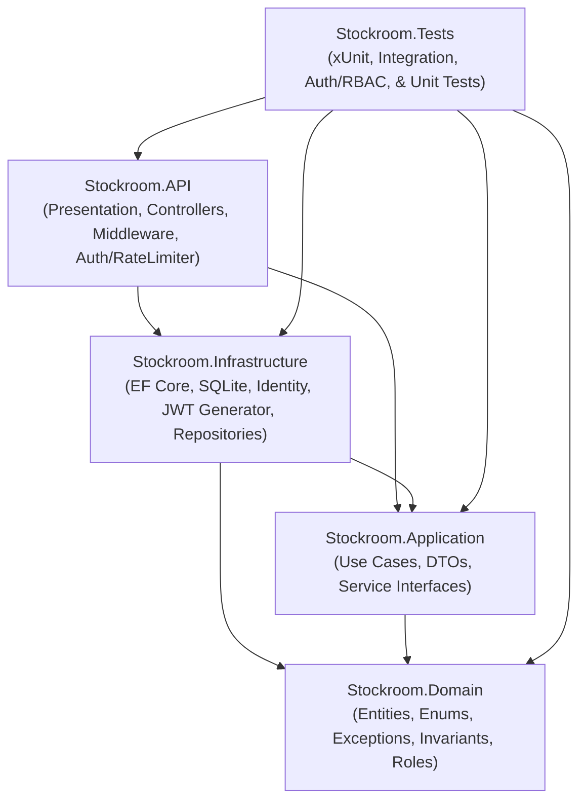

# Stockroom — Inventory Management REST API

Stockroom is a production-grade, lightweight Inventory Management REST API built with **C#** and **ASP.NET Core** following the principles of **Clean Architecture**. It features **JWT Bearer Authentication**, **Role-Based Access Control (RBAC)**, end-to-end inventory tracking, stock movements audit logging, low-stock threshold alerting, and real-time inventory valuation.

---

## Table of Contents

- [Overview & Problem Solved](#overview--problem-solved)
- [Key Features](#key-features)
- [Architecture & Design](#architecture--design)
- [Technology Stack](#technology-stack)
- [Security & Authentication Architecture](#security--authentication-architecture)
  - [Role-Based Access Control (RBAC) Matrix](#role-based-access-control-rbac-matrix)
  - [Initial Administrator Provisioning](#initial-administrator-provisioning)
  - [JWT Configuration & Key Management](#jwt-configuration--key-management)
  - [API Hardening & Rate Limiting](#api-hardening--rate-limiting)
- [Project Structure](#project-structure)
- [Prerequisites](#prerequisites)
- [Getting Started](#getting-started)
- [Database Migrations](#database-migrations)
- [API Endpoints & Documentation](#api-endpoints--documentation)
  - [Authentication](#authentication)
  - [User & Role Administration](#user--role-administration)
  - [Products](#products)
  - [Stock Operations & Audit History](#stock-operations--audit-history)
  - [Inventory Reporting](#inventory-reporting)
- [Business Rules & Invariants](#business-rules--invariants)
- [Validation & Error Handling](#validation--error-handling)
- [Testing](#testing)
- [Known Limitations](#known-limitations)
- [Future Improvements](#future-improvements)

---

## Overview & Problem Solved

Traditional inventory systems frequently suffer from data anomalies and unauthorized tampering:
1. **Uncontrolled stock tampering**: Direct balance adjustments without audit trails or role verification.
2. **Negative inventory**: Overselling or removing more units than actually exist in the warehouse.
3. **Audit trail deletion**: Deleting catalog items that destroy historic financial ledger records.
4. **Floating-point rounding errors**: Precision loss when aggregating stock values.
5. **Credential vulnerabilities**: Hardcoded secrets, plaintext passwords, or vulnerable auth schemes.

**Stockroom solves these problems** by:
- Enforcing **secure JWT bearer authentication** with ASP.NET Core Identity (PBKDF2 password hashing).
- Defining a strict **3-tier RBAC permission model** (`Admin`, `InventoryManager`, `Viewer`).
- Enforcing **domain-level business invariants** (non-negative stock, positive adjustment quantities).
- Guaranteeing **atomic persistence**: product balance changes and immutable audit movements either persist together or fail together.
- Recording an **immutable audit log** for every stock-in and stock-out event (including initial balances upon product creation).
- Prohibiting deletion of products that have historic movement history or active stock.
- Implementing **partitioned brute-force rate limiting** and **HTTP security defense headers**.
- Performing **safe decimal arithmetic** for financial valuations.

---

## Key Features

- **JWT Authentication**: Secure stateless authentication using HMAC-SHA256 signed JWT tokens with configurable expiration.
- **Role-Based Access Control (RBAC)**: Fine-grained authorization policies guarding every inventory and management endpoint.
- **Product Catalog Management**: Create, view, update, and search products with unique SKU enforcement, pagination, and filtering.
- **Atomic Stock Adjustments**: Dedicated `/stock-in` and `/stock-out` endpoints that guarantee balance updates and audit trail persistence inside database transactions.
- **Immutable Movement Audit Records**: Chronological, read-only ledger capturing before/after balances, quantities, timestamps (UTC), and optional transaction notes.
- **User & Role Administration**: Admin-only APIs to inspect users and assign roles, with safety guards preventing accidental removal of the last administrator.
- **Brute-Force Rate Limiting**: Client-partitioned rate limiting on authentication endpoints returning HTTP `429 Too Many Requests`.
- **Low-Stock Alerting**: Instant detection of products needing replenishment (`QuantityInStock <= LowStockThreshold`). Products configured with a threshold of `0` are intentionally excluded from alerts.
- **Inventory Valuation & Metrics**: High-level reporting of total catalog items, total units on hand, low-stock item count, and cumulative inventory value calculated in memory using exact decimal arithmetic.
- **RFC 9110 / RFC 7807 Compliance**: Centralized error handling returning standardized `ProblemDetails` for 400 Bad Request, 401 Unauthorized, 403 Forbidden, 404 Not Found, 409 Conflict, and 500 Internal Server Error without leaking internal stack traces.
- **Interactive Developer UI**: Integrated **Scalar** interactive API documentation alongside OpenAPI specifications.

---

## Architecture & Design

Stockroom follows **Clean Architecture** (Ports and Adapters / Onion Architecture). Dependencies strictly point inward toward the Domain core:



### Dependency Rules:
1. **Stockroom.Domain**: Contains core business entities (`Product`, `StockMovement`), domain exceptions, role constants (`Roles.Admin`, `Roles.InventoryManager`, `Roles.Viewer`), and domain logic. Has zero external dependencies.
2. **Stockroom.Application**: Defines repository abstractions (`IProductRepository`, `IStockMovementRepository`, `IUnitOfWork`), authentication/admin service interfaces (`IAuthService`, `IUserAdminService`), request/response DTOs, and orchestrates use cases. Depends only on Domain.
3. **Stockroom.Infrastructure**: Implements persistence using Entity Framework Core and SQLite, configures ASP.NET Core Identity (`ApplicationUser : IdentityUser`), generates JWT tokens, runs migrations, and handles database transactions. Depends on Application and Domain.
4. **Stockroom.API**: Presentation layer containing ASP.NET Core controllers (`AuthController`, `AdminController`, `ProductsController`, `InventoryController`), JWT Bearer authentication, authorization policies, rate limiting, OpenAPI / Scalar configuration, and centralized `GlobalExceptionHandler`. Acts as the composition root.
5. **Stockroom.Tests**: Unit and integration tests validating domain rules, application services, auth flows, RBAC policies, and full HTTP endpoints via `WebApplicationFactory`.

---

## Security & Authentication Architecture

### Role-Based Access Control (RBAC) Matrix

| Endpoint | Verb | Anonymous | Viewer | InventoryManager | Admin |
|---|---|:---:|:---:|:---:|:---:|
| `/api/auth/register` | `POST` | ✅ | ✅ | ✅ | ✅ |
| `/api/auth/login` | `POST` | ✅ | ✅ | ✅ | ✅ |
| `/api/auth/me` | `GET` | ❌ (401) | ✅ | ✅ | ✅ |
| `/api/admin/users` | `GET` | ❌ (401) | ❌ (403) | ❌ (403) | ✅ |
| `/api/admin/users/{id}` | `GET` | ❌ (401) | ❌ (403) | ❌ (403) | ✅ |
| `/api/admin/users/{id}/roles` | `PUT` | ❌ (401) | ❌ (403) | ❌ (403) | ✅ |
| `/api/products` | `GET` | ❌ (401) | ✅ | ✅ | ✅ |
| `/api/products/{id}` | `GET` | ❌ (401) | ✅ | ✅ | ✅ |
| `/api/products/{id}/movements` | `GET` | ❌ (401) | ✅ | ✅ | ✅ |
| `/api/inventory/low-stock` | `GET` | ❌ (401) | ✅ | ✅ | ✅ |
| `/api/inventory/summary` | `GET` | ❌ (401) | ✅ | ✅ | ✅ |
| `/api/products` | `POST` | ❌ (401) | ❌ (403) | ✅ | ✅ |
| `/api/products/{id}` | `PUT` | ❌ (401) | ❌ (403) | ✅ | ✅ |
| `/api/products/{id}/stock-in` | `POST` | ❌ (401) | ❌ (403) | ✅ | ✅ |
| `/api/products/{id}/stock-out` | `POST` | ❌ (401) | ❌ (403) | ✅ | ✅ |
| `/api/products/{id}` | `DELETE` | ❌ (401) | ❌ (403) | ❌ (403) | ✅ |

### Initial Administrator Provisioning

To prevent insecure privilege escalation, public registration requests (`POST /api/auth/register`) **never accept client-supplied roles** and assign the `Viewer` role by default.

The initial administrator is provisioned safely and idempotently on startup from configuration:
- In `appsettings.Development.json` (for local development):
  ```json
  "InitialAdmin": {
    "Email": "admin@stockroom.local",
    "Password": "AdminPassword123!"
  }
  ```
- In production, set environment variables:
  ```bash
  export InitialAdmin__Email="admin@yourdomain.com"
  export InitialAdmin__Password="YourStrongAdminPassword123!"
  ```
The startup seeder checks if an account with this email exists; if not, it provisions the administrator with `Admin`, `InventoryManager`, and `Viewer` roles. If it already exists, the seeder does **not** overwrite passwords or alter existing privileges.

### JWT Configuration & Key Management

JWT configuration is managed under the `Jwt` section:
```json
"Jwt": {
  "Issuer": "StockroomAPI",
  "Audience": "StockroomClients",
  "SecretKey": "",
  "ExpirationMinutes": 60
}
```

> [!CAUTION]
> The application enforces **fail-safe startup validation**: if `Jwt:SecretKey` is missing or shorter than 32 characters (256 bits), the API **refuses to start**, preventing silent fallbacks to insecure keys.

#### Setting the Secret Key:
- **Local Development**: Configure via .NET User Secrets:
  ```bash
  cd src/Stockroom.API
  dotnet user-secrets set "Jwt:SecretKey" "Your32ByteOrLongerSecureSigningSecretKeyHere!"
  ```
- **Deployed Environments**: Set the environment variable:
  ```bash
  export Jwt__SecretKey="YourProduction32ByteOrLongerCryptographicKey!"
  ```

### API Hardening & Rate Limiting

1. **Brute-Force Resistance**: Authentication endpoints (`/api/auth/login` and `/api/auth/register`) are protected with partitioned fixed-window rate limiting. Clients exceeding 100 requests per minute receive HTTP `429 Too Many Requests`.
2. **Security Headers**: Standard defense-in-depth headers are injected on all HTTP responses:
   - `X-Content-Type-Options: nosniff`
   - `X-Frame-Options: DENY`
   - `Referrer-Policy: strict-origin-when-cross-origin`
   - `X-XSS-Protection: 0`
3. **No User Enumeration**: Login requests with incorrect emails or passwords return an identical generic error message (`Invalid email or password.`) with HTTP 401.
4. **Mass Assignment Protection**: Endpoints accept explicit DTO records; domain entities and Identity models are never bound directly to HTTP request bodies.

---

## Technology Stack

- **Platform / SDK**: .NET 10 (C# 13)
- **Framework**: ASP.NET Core Web API with Controllers
- **Security & Identity**: ASP.NET Core Identity Core (`Microsoft.AspNetCore.Identity.EntityFrameworkCore`)
- **JWT Authentication**: `Microsoft.AspNetCore.Authentication.JwtBearer` (HMAC-SHA256)
- **Rate Limiting**: Built-in ASP.NET Core Rate Limiting Middleware
- **ORM**: Entity Framework Core 10 (`Microsoft.EntityFrameworkCore.Sqlite`)
- **Database**: SQLite (local file-based storage with transactional support)
- **API Documentation**: Microsoft OpenAPI (`Microsoft.AspNetCore.OpenApi`) + **Scalar** (`Scalar.AspNetCore`)
- **Testing**: xUnit, `Microsoft.AspNetCore.Mvc.Testing`, SQLite In-Memory

---

## Project Structure

```
Stockroom/
├── Stockroom.sln                                # Visual Studio solution
├── Stockroom.slnx                               # Modern XML solution
├── dotnet-tools.json                            # Local .NET CLI tool manifest (dotnet-ef)
├── .gitignore                                   # Git ignore rules (secrets, databases, build artifacts)
├── README.md                                    # Documentation
├── src/
│   ├── Stockroom.Domain/                        # Domain Layer (Enterprise Core)
│   │   ├── Common/
│   │   │   └── Roles.cs                         # Role constants (Admin, InventoryManager, Viewer) & Policies
│   │   ├── Entities/
│   │   │   ├── Product.cs                       # Product aggregate & business invariants
│   │   │   └── StockMovement.cs                 # Immutable audit movement entity
│   │   ├── Enums/
│   │   │   └── StockMovementType.cs             # StockIn, StockOut
│   │   └── Exceptions/
│   │       └── DomainExceptions.cs              # Domain-specific business & security exceptions
│   │
│   ├── Stockroom.Application/                   # Application Layer (Use Cases)
│   │   ├── DTOs/
│   │   │   ├── Auth/AuthDTOs.cs                 # Register, Login, CurrentUser, Admin DTOs
│   │   │   ├── Common/PagedResponse.cs          # Generic pagination wrapper
│   │   │   ├── Products/ProductDTOs.cs          # Create/Update/Query Product DTOs
│   │   │   ├── StockMovements/StockMovementDTOs.cs # StockIn/StockOut request/response DTOs
│   │   │   └── Inventory/InventoryDTOs.cs       # Inventory summary DTOs
│   │   ├── Interfaces/
│   │   │   ├── IAuthService.cs                  # Auth & User admin service interfaces
│   │   │   ├── IProductRepository.cs
│   │   │   ├── IStockMovementRepository.cs
│   │   │   ├── IUnitOfWork.cs
│   │   │   ├── IProductService.cs
│   │   │   └── IInventoryService.cs
│   │   ├── Services/
│   │   │   ├── ProductService.cs                # Product catalog use cases
│   │   │   └── InventoryService.cs              # Stock management & metrics use cases
│   │   └── DependencyInjection.cs
│   │
│   ├── Stockroom.Infrastructure/                # Infrastructure Layer (Data & Persistence)
│   │   ├── Authentication/
│   │   │   ├── JwtOptions.cs                    # Configurable JWT model
│   │   │   └── JwtTokenGenerator.cs             # HMAC-SHA256 token generator
│   │   ├── Data/
│   │   │   ├── StockroomDbContext.cs            # IdentityDbContext<ApplicationUser>
│   │   │   ├── StockroomDbContextFactory.cs     # Design-time factory for EF CLI
│   │   │   ├── UnitOfWork.cs                    # Transaction & save changes coordinator
│   │   │   ├── Configurations/                  # EF entity mappings
│   │   │   └── Migrations/                      # EF Core SQLite schema migrations
│   │   ├── Identity/
│   │   │   ├── ApplicationUser.cs               # IdentityUser extension
│   │   │   └── IdentitySeeder.cs                # Idempotent role & initial admin seeder
│   │   ├── Repositories/
│   │   │   ├── ProductRepository.cs
│   │   │   └── StockMovementRepository.cs
│   │   ├── Services/
│   │   │   ├── AuthService.cs                   # Identity registration & login implementation
│   │   │   └── UserAdminService.cs              # Role & user management implementation
│   │   └── DependencyInjection.cs
│   │
│   └── Stockroom.API/                           # Presentation Layer (API Host)
│       ├── Controllers/
│       │   ├── AuthController.cs                # Register, Login, Me endpoints
│       │   ├── AdminController.cs               # Admin user & role management endpoints
│       │   ├── ProductsController.cs            # Product & stock management endpoints
│       │   └── InventoryController.cs           # Low-stock & summary reporting endpoints
│       ├── Middleware/
│       │   ├── GlobalExceptionHandler.cs        # Centralized RFC 9110 ProblemDetails handler
│       │   └── SecurityHeadersMiddleware.cs     # Defense-in-depth HTTP headers
│       ├── Program.cs                           # Composition root & middleware pipeline
│       ├── Stockroom.API.http                   # Interactive HTTP test requests
│       ├── appsettings.json
│       └── appsettings.Development.json
│
└── tests/
    └── Stockroom.Tests/                         # Automated Tests
        ├── Domain/
        │   ├── ProductTests.cs                  # Unit tests for domain invariants
        │   └── StockMovementTests.cs            # Unit tests for movement records
        ├── Application/
        │   ├── ProductServiceTests.cs           # Use case & business logic tests
        │   └── InventoryServiceTests.cs         # Stock adjustment & report tests
        ├── Integration/
        │   ├── CustomWebApplicationFactory.cs   # In-memory test host setup with JWT helpers
        │   ├── AuthAndRbacTests.cs              # Authentication, JWT, and RBAC tests
        │   └── ApiEndpointsTests.cs             # Full E2E HTTP integration tests
        └── TestHelpers/
            └── SqliteTestDatabase.cs            # Isolated SQLite in-memory helper
```

---

## Prerequisites

- [.NET 10 SDK](https://dotnet.microsoft.com/download)
- Terminal / CLI (macOS, Linux, or Windows)

Verify your installed SDK version:
```bash
dotnet --version
```

---

## Getting Started

### 1. Clone the repository
```bash
git clone <repository-url>
cd Stockroom
```

### 2. Restore local tools & packages
```bash
dotnet tool restore
dotnet restore
```

### 3. Build the solution
```bash
dotnet build Stockroom.sln
```

### 4. Run the API
```bash
dotnet run --project src/Stockroom.API
```

The application will automatically apply database migrations and seed the initial roles and administrator account (`admin@stockroom.local` / `AdminPassword123!`).

### 5. Access Interactive API Documentation
Open your browser to:
- **Scalar UI**: `http://localhost:5008/scalar/v1` (or URL displayed in console)
- **OpenAPI Document**: `http://localhost:5008/openapi/v1.json`

---

## Database Migrations

Entity Framework Core migrations manage both inventory tables and ASP.NET Core Identity tables.

To apply migrations manually:
```bash
dotnet dotnet-ef database update \
  --project src/Stockroom.Infrastructure \
  --startup-project src/Stockroom.Infrastructure
```

To create a new migration:
```bash
dotnet dotnet-ef migrations add <MigrationName> \
  --project src/Stockroom.Infrastructure \
  --startup-project src/Stockroom.Infrastructure \
  --output-dir Data/Migrations
```

---

## API Endpoints & Documentation

All protected endpoints require the following header:
```http
Authorization: Bearer <your-jwt-token>
```

### Authentication

#### 1. Register
- **Method**: `POST`
- **Route**: `/api/auth/register`
- **Anonymous**: Allowed (Rate limited)
- **Description**: Registers a new user. The user is assigned the `Viewer` role by default.

**Request Body**:
```json
{
  "email": "warehouse.staff@stockroom.local",
  "password": "SecurePassword123!"
}
```

**Response (200 OK)**:
```json
{
  "token": "eyJhbGciOiJIUzI1NiIsInR5cCI6...",
  "tokenType": "Bearer",
  "expiresAtUtc": "2026-10-15T14:30:00Z",
  "userId": "b4c19ef0-0321-4f10-b98a-77e8dbd92831",
  "email": "warehouse.staff@stockroom.local",
  "roles": ["Viewer"]
}
```

---

#### 2. Login
- **Method**: `POST`
- **Route**: `/api/auth/login`
- **Anonymous**: Allowed (Rate limited)
- **Description**: Validates credentials and returns a signed JWT access token.

**Request Body**:
```json
{
  "email": "admin@stockroom.local",
  "password": "AdminPassword123!"
}
```

**Response (200 OK)**:
```json
{
  "token": "eyJhbGciOiJIUzI1NiIsInR5cCI6...",
  "tokenType": "Bearer",
  "expiresAtUtc": "2026-10-15T14:30:00Z",
  "userId": "d748f34b-2b4a-4422-b516-7782631cf547",
  "email": "admin@stockroom.local",
  "roles": ["Admin", "InventoryManager", "Viewer"]
}
```

---

#### 3. Current User Profile
- **Method**: `GET`
- **Route**: `/api/auth/me`
- **Authorization**: Required (`Viewer`, `InventoryManager`, or `Admin`)
- **Description**: Returns the authenticated user's profile and assigned roles without exposing sensitive fields.

---

### User & Role Administration

*All administration endpoints require the `Admin` role.*

#### 1. List Users
- **Method**: `GET`
- **Route**: `/api/admin/users`
- **Authorization**: `Admin` only
- **Response**: List of users with their IDs, emails, and assigned roles.

#### 2. Get User by ID
- **Method**: `GET`
- **Route**: `/api/admin/users/{id}`
- **Authorization**: `Admin` only

#### 3. Update User Roles
- **Method**: `PUT`
- **Route**: `/api/admin/users/{id}/roles`
- **Authorization**: `Admin` only
- **Description**: Replaces the user's roles with the specified list. Validates role names and prevents removing the `Admin` role from the last active administrator.

**Request Body**:
```json
{
  "roles": ["InventoryManager"]
}
```

---

### Products

#### 1. Create Product
- **Method**: `POST`
- **Route**: `/api/products`
- **Authorization**: `Admin` or `InventoryManager`
- **Description**: Creates a new product. If `initialQuantity > 0`, an initial `StockIn` movement is atomically recorded.

**Request Body**:
```json
{
  "name": "Mechanical Keyboard Pro",
  "sku": "KB-MECH-01",
  "description": "Tenkeyless mechanical keyboard with hot-swappable switches",
  "unitPrice": 129.99,
  "initialQuantity": 25,
  "lowStockThreshold": 5
}
```

---

#### 2. List Products
- **Method**: `GET`
- **Route**: `/api/products?page=1&pageSize=10&search=keyboard&lowStockOnly=false`
- **Authorization**: `Viewer`, `InventoryManager`, or `Admin`

---

#### 3. Get Product by ID
- **Method**: `GET`
- **Route**: `/api/products/{id}`
- **Authorization**: `Viewer`, `InventoryManager`, or `Admin`

---

#### 4. Update Product Metadata
- **Method**: `PUT`
- **Route**: `/api/products/{id}`
- **Authorization**: `Admin` or `InventoryManager`
- **Description**: Updates product details (name, SKU, description, unit price, low-stock threshold). **Does not alter inventory balance**.

---

#### 5. Delete Product
- **Method**: `DELETE`
- **Route**: `/api/products/{id}`
- **Authorization**: `Admin` only
- **Rule**: Deletion is prohibited and returns `409 Conflict` if the product has existing stock movement audit records (to preserve ledger integrity) or if the product has a remaining stock balance > 0.

---

### Stock Operations & Audit History

#### 1. Receive Stock (Stock-In)
- **Method**: `POST`
- **Route**: `/api/products/{id}/stock-in`
- **Authorization**: `Admin` or `InventoryManager`
- **Description**: Atomically increments stock balance and records a `StockIn` movement audit log.

**Request Body**:
```json
{
  "quantity": 10,
  "note": "Received supplier shipment PO #8821"
}
```

---

#### 2. Remove Stock (Stock-Out)
- **Method**: `POST`
- **Route**: `/api/products/{id}/stock-out`
- **Authorization**: `Admin` or `InventoryManager`
- **Description**: Atomically decrements stock balance and records a `StockOut` movement audit log. Fails with `409 Conflict` if requested quantity exceeds available stock.

**Request Body**:
```json
{
  "quantity": 5,
  "note": "Dispatched order #SO-9910"
}
```

---

#### 3. View Movement History
- **Method**: `GET`
- **Route**: `/api/products/{id}/movements?page=1&pageSize=10`
- **Authorization**: `Viewer`, `InventoryManager`, or `Admin`
- **Description**: Returns immutable audit movements for the product, sorted newest first.

---

### Inventory Reporting

#### 1. Low-Stock Report
- **Method**: `GET`
- **Route**: `/api/inventory/low-stock`
- **Authorization**: `Viewer`, `InventoryManager`, or `Admin`
- **Description**: Retrieves products where `QuantityInStock <= LowStockThreshold`. Products configured with `LowStockThreshold == 0` are excluded.

---

#### 2. Inventory Summary
- **Method**: `GET`
- **Route**: `/api/inventory/summary`
- **Authorization**: `Viewer`, `InventoryManager`, or `Admin`
- **Description**: Summarizes total products, total units, low-stock count, and cumulative decimal valuation (`Sum(UnitPrice * QuantityInStock)`).

---

## Business Rules & Invariants

1. **Role Separation**: `Viewer` can only read; `InventoryManager` can adjust inventory and edit products but cannot delete products or manage users; `Admin` has full access.
2. **Default Role**: Newly registered users always receive `Viewer`. Roles cannot be requested during registration.
3. **Admin Protection**: The last active administrator in the system cannot be demoted or have their Admin role removed.
4. **SKU Uniqueness**: SKUs are normalized (trimmed, uppercase) and strictly unique, enforced by application validation and database constraint.
5. **Non-Negative Invariants**: `UnitPrice >= 0`, `QuantityInStock >= 0`, `LowStockThreshold >= 0`.
6. **Adjustment Quantities**: Stock movements require positive integers (`quantity > 0`).
7. **Audit Immutability**: Historical `StockMovement` records cannot be updated or deleted through the API.
8. **Audit Preservation on Delete**: Products cannot be deleted if historical movements exist or if positive stock remains.
9. **Zero-Threshold Alert Exclusion**: Products configured with `LowStockThreshold = 0` are excluded from low-stock alerts.
10. **Decimal Precision**: Money and unit prices strictly use `decimal` in C# and fixed-point mappings in SQLite.

---

## Validation & Error Handling

- **Request Validation**: Model attributes enforce mandatory fields, string length bounds, email format, and numeric ranges.
- **ProblemDetails (RFC 9110 / RFC 7807)**:
  - `400 Bad Request`: Input validation errors or invalid role names.
  - `401 Unauthorized`: Missing, expired, or invalid JWT bearer token, or invalid login credentials.
  - `403 Forbidden`: Authenticated user lacks the required role for the endpoint.
  - `404 Not Found`: Resource ID does not exist.
  - `409 Conflict`: Duplicate SKU, duplicate user registration email, insufficient stock for stock-out, or prohibited deletion.
  - `429 Too Many Requests`: Client exceeded authentication rate limit (100 requests / minute).
  - `500 Internal Server Error`: Unhandled server exceptions logged via structured logging, returning safe generic messages without stack traces.

---

## Testing

The project includes **69 automated tests** covering:
- **Domain Invariants**: Entity behaviors (`ProductTests`, `StockMovementTests`).
- **Application Services**: Catalog workflows, inventory calculations, and concurrency conflict detection (`ProductServiceTests`, `InventoryServiceTests`).
- **Authentication & RBAC**: Default `Viewer` assignment, password hashing verification, JWT generation, expired/tampered token rejection, role permissions verification, last-admin demotion prevention, and rate limiting (`AuthAndRbacTests`).
- **HTTP Integration**: End-to-end API verification via `WebApplicationFactory` with in-memory SQLite (`ApiEndpointsTests`).

To execute all tests:
```bash
dotnet test Stockroom.sln
```

Sample output:
```
Passed!  - Failed: 0, Passed: 69, Skipped: 0, Total: 69, Duration: 1 s - Stockroom.Tests.dll (net10.0)
```

---

## Known Limitations

- **SQLite Concurrency & Locking**: SQLite operates on file-level locks. While SQLite supports concurrent reads, write operations lock the database file. Under heavy write loads, operations queue or encounter database busy timeouts.
- **Concurrency Token Protection**: To safeguard against lost updates in concurrent environments, `Product` includes a `ConcurrencyVersion` token configured with EF Core's `[ConcurrencyCheck]`. When conflicting updates occur, a `409 Conflict` is returned.
- **JWT Revocation**: JWT tokens are stateless and remain valid until their expiration timestamp (`exp`). Immediate token revocation (e.g., blacklisting or refresh-token rotation) is not currently implemented; access token lifetimes are kept configurable and reasonably short (default: 60 minutes).

---

## Future Improvements

- **Refresh Token Rotation**: Implement short-lived access tokens (15 minutes) paired with secure, httpOnly refresh tokens and sliding revocation.
- **Suppliers & Purchase Orders**: Expand domain model to track vendor contacts, purchase orders (POs), and automated stock receipts upon PO fulfillment.
- **Multi-Factor Authentication (MFA)**: Support TOTP (Time-based One-Time Password) apps for administrative logins.
- **Barcode & QR Scanning**: Support UPC/EAN scanning workflows and thermal label generation.
- **Webhooks & Email Alerts**: Dispatch automated notifications when products drop below low-stock thresholds.
- **Production Containerization**: Dockerfile and deployment manifests for Kubernetes or AWS ECS with PostgreSQL or SQL Server.
